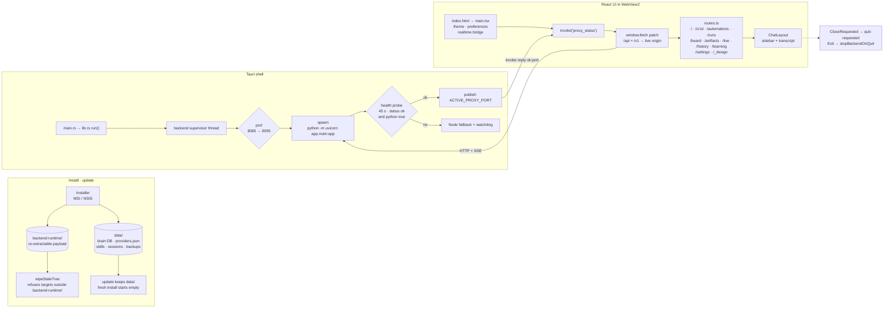
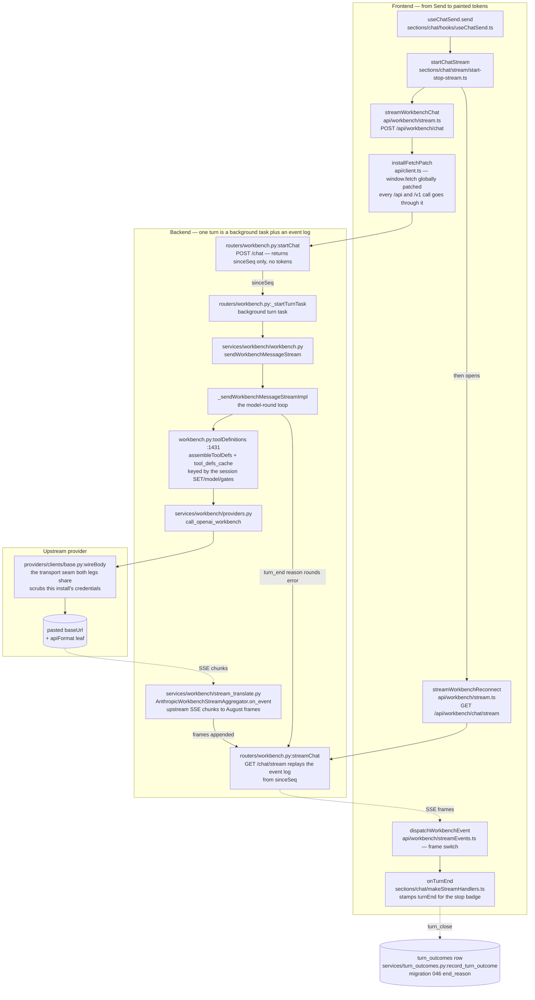
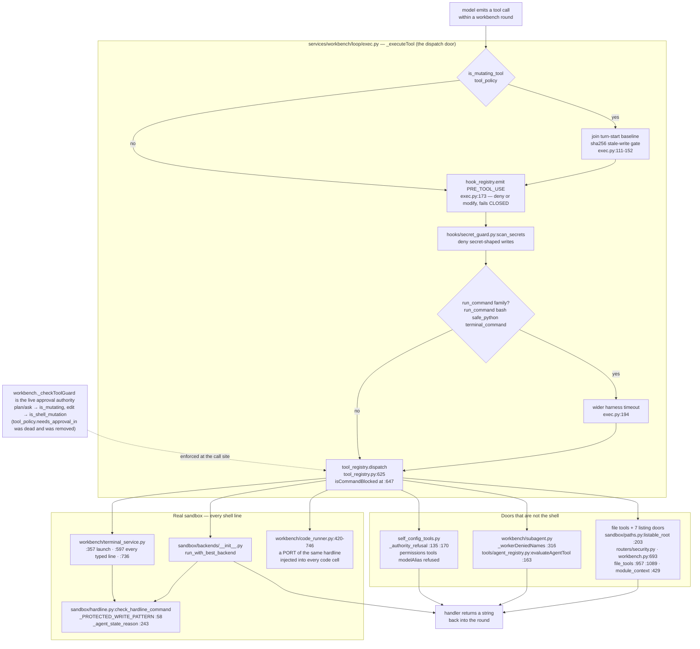
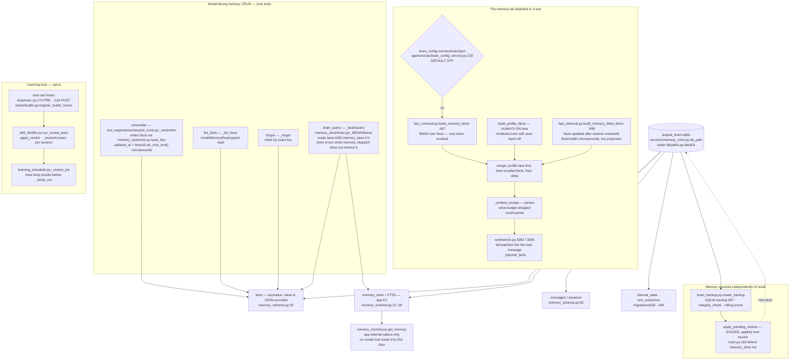
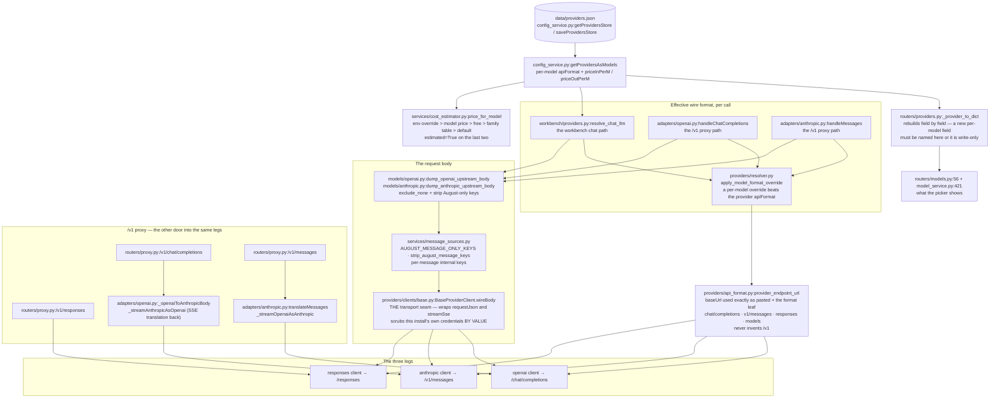
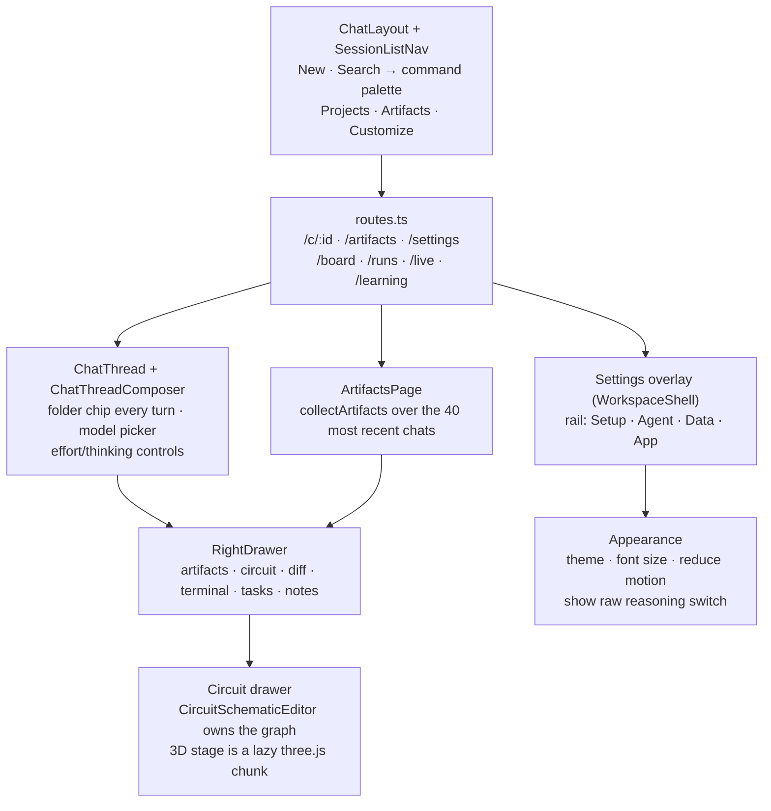

# How August really flows (code map)

Six diagrams: five runtime flows plus the current app surface. **Every box
names a real file and symbol** — nothing here is a sketch of an intended
architecture. The chains were read out of the tree (path and function
confirmed), and the SVG snapshot is committed beside this file as
[`architecture-flow.html`](architecture-flow.html) for offline viewing.

The right way to use this page: when a bug report says "the turn just stopped",
find which diagram owns that step and read the named function. The
"not what it looks like" lists under each diagram are the parts that mislead on
a first read.

Diagrams:

1. Install / update → Tauri shell → React boot
2. One chat turn end to end
3. Tool calls and the gates that stand in front of them
4. Memory: what the model sees, writes, and what survives
5. Provider routing and wire formats
6. App surfaces and navigation (the current shell)

---

## 1. Install, update, shell, boot

- `{appData}/data` and `{appData}/backend-runtime` are **siblings, never
  nested** — `scripts/desktop-backend-payload.mjs` refuses to stage user state
  into the payload, and `wipeStaleTree` (`src-tauri/src/backend.rs`) refuses any
  recursive delete outside `backend-runtime/`.
- The WebView renders the same Vite bundle that FastAPI can serve from
  `web-dist/`; the desktop app is the product, the served copy is packaging.
- The `/_design` route is compiled **only in dev** (`routes.ts` keeps the
  `lazy()` import inside the `import.meta.env.DEV` branch, so production ships no
  DesignRoute chunk).

---

## 2. One chat turn, end to end

**Not what it looks like**

- The `POST /api/workbench/chat` response body carries **no tokens** — only
  `sinceSeq`. The turn runs as a background task
  (`routers/workbench.py:_startTurnTask`) and the frontend immediately opens
  `GET /api/workbench/chat/stream`, which replays the session's event log from
  that sequence. "Streaming" here is a replayed log, not a held HTTP response.
- `window.fetch` is globally patched by `api/client.ts:installFetchPatch`; the
  chat stream is one of the calls that arrives at the patch, not through an
  `api` helper.
- The frontend's stream-apply module is `api/workbench/streamEvents.ts`
  (`dispatchWorkbenchEvent`), while the per-frame React handlers live in
  `sections/chat/makeStreamHandlers.ts`. Two files, one frame vocabulary.
- `stream_translate.py` lives under `services/workbench/`, **not** under
  `adapters/`.
- Every turn ends with a `turn_end {reason, rounds, error}` frame; the same
  reason + counters are persisted by `record_turn_outcome` into `turn_outcomes`
  (migration 046), where NULL means unrecorded, not zero. `stall-stop` is the
  runaway backstop's reason, reused deliberately so the badge, the ledger and
  the docs read one vocabulary.
- The provider tool array is a **session** value, not a per-turn one:
  `_sessionToolDefsCacheKey` (`workbench.py:1392`) keys the final disclosed and
  filtered array on the base set, model profile, context window and session
  gates. The BM25 query chooses membership on the first build and is
  deliberately not part of the key; `_applySessionStableOrder`
  (`loop/surface.py:224`) keeps a name's slot when the set changes. A changed
  set or gate still misses and rebuilds.

---

## 3. Tool calls and the gates in front of them

**Not what it looks like**

- `_executeTool` is the one door every chat tool call passes (`loop/exec.py:58`),
  and it ends in `tool_registry.dispatch` (`tool_registry.py:625`, imported at
  `exec.py:73`). There is no second dispatch path for aliases: `bulk` routes
  `operation=<x>` to the same handlers from inside `dispatch`.
- **Approval policy lives in `workbench._checkToolGuard`, not in
  `tool_policy.needs_approval_in`.** That predicate had no call site and was
  removed; `_checkToolGuard` is called by the workbench loop, the subagent
  runner and the kernel, and it uses `is_mutating` for plan/ask and
  `is_shell_mutation` for edit. `ask` and `full` do NOT behave the same:
  `full` returns early, while `ask` queues a pending mutation that the user
  must accept. (The old text here concluded the opposite from the dead
  predicate and was wrong.)
- The hardline rules are not one implementation. `sandbox/hardline.py` is the
  source, `workbench/code_runner.py:420-746` is a **port** rendered into every
  code cell (it cannot import `app`), and `terminal_service.py` calls the
  original on every typed line. A rule added to one and not the others is the
  known drift class here.
- The seven listing doors all call `sandbox/paths.py:listable_root` then
  `listable_entry`/`listable_child`; the write door
  (`_agent_state_reason`, `_PROTECTED_WRITE_PATTERN`) lives in the hardline
  module and protects agent state (skills layers, `hooks.json`,
  `mcp-servers.json`, `automations.json`, kernel `site-packages`, the brain DB).
- Sub-agent capability is a **deny set** (`_workerDeniedNames` +
  `_workerDenied` published on `currentSubagentDenied`), never an allow-list of
  the offered surface — progressive disclosure means a worker may legitimately
  call a tool outside the slice it was shown.

---

## 4. Memory: what the model sees, what it can write, what survives

**Not what it looks like**

- `memoryAutoInject` is **off by default**, but that gate only governs the
  recalled-facts lane: `build_profile_block` (the `kind='profile'` facts) is
  rendered on every turn regardless. That is what makes August remember *who
  you are* without a keyword coincidence.
- Recalled facts are attached to the **user message** at
  `workbench.py:3188`/`:3283` (`_injected_facts`), not to the system prompt.
- The delta lane (`build_memory_delta_block`, `fact_retrieval.py:958`) is a
  live projection over `facts.updated_at`, not a cursor: an UPDATE is
  delivered like a new write, a retired row is excluded, and keys the recall
  lane already showed are skipped. It used to compare a second-resolution
  `updated_at` against a microsecond session stamp, which hid writes made in
  the session's opening second. Fact writers now stamp
  `timeutil.utc_now_text()` (fixed-width UTC microseconds) and the lane
  compares those strings directly, so same-second writes are visible.
- A fact value is **stored JSON-encoded**; every read door decodes it. Write one
  and read it back through a different door and a raw JSON blob is a
  serialization bug, not a data bug.
- `remember`/`list_facts`/`forget` are core tools (never hidden by progressive
  disclosure) and `list_facts` is gated by `modelMemoryRead`. Since 2026-10-17
  the read is also a **precondition**: `remember` refuses its first write of a
  turn until memory was read that turn, and refuses a sentence already stored
  under another key (naming it in `existingKey`). `list_facts` pages with
  `offset`/`hasMore`/`total` and takes `include_retired`.
- `brain_query` can read the KV table (`store='memory'`, aliases `kv` /
  `memory_store` — `memory_store/brain.py:_BRAINStores`), and as of 2026-10-17
  `memory` is in the advertised store enum: the composer's Notes lane is
  reachable through a **named** door, not an unadvertised alias. Dispatch still
  does not validate the enum, so a stale client using an alias keeps working.
- The learning pass is opt-in and per-session: `run_review_pass` keeps a
  **cursor map** in `internal_state` (`skill_distiller:review:cursors`), not one
  global high-water id, and its job adapter must drop `results` before returning
  (`_finish_run` truncates detail at 2000 chars).
- Backups are online SQLite copies (`create_backup`), verified with
  `PRAGMA integrity_check` before trust; a restore is **staged** and applied at
  the next launch (`apply_pending_restore` runs in `main.py:184` before the
  store initializes) — never in place.

---

## 5. Provider routing and wire formats

**Not what it looks like**

- One provider entry can serve several wire formats: `apiFormat` is per
  provider, and a **model** entry may carry its own override
  (`apply_model_format_override`, consulted by the workbench, the Test button,
  Live/BTW and both `/v1` adapters). OpenCode Zen is the motivating case.
- The base URL is used **exactly as pasted**; `provider_endpoint_url` appends
  only the format leaf. It never invents `/v1` — OpenAI-compatible hosts include
  it in the paste, and Anthropic's format already has `v1` inside its leaf.
- The credential scrub is in `BaseProviderClient.wireBody` — the transport seam
  wrapping `requestJson`/`streamSse` — **not** in the `dump_*` serializers,
  because the workbench assigns `body['messages']` after dumping and the `/v1`
  proxy appends tool results and re-sends. Matched by **value**, so key-shaped
  text a user pasted survives.
- `_provider_to_dict` and `getProvidersAsModels` rebuild model entries field by
  field: a new per-model field must be named in both or it is write-only.
- `0.0` is a price, not an absence (only `None` means unset), and
  `price_for_model` is the **only** pricing source, returning
  `estimated: True` for the family-table and default fallbacks so a readout can
  distinguish a fact from a guess.

---

## 6. App surfaces and navigation (the current shell)

**Not what it looks like**

- **Search** is the command palette (`toggleCommandPalette`), not a full-text
  page. The reference's Search row and `Ctrl+K` are the same door.
- The **Projects** row opens the composer's folder picker. The picker is
  mounted on every turn, not only an empty chat, so the row works in an active
  conversation. Clearing a folder is sent to the backend before the local row
  is cleared; a failed POST leaves the old folder visible.
- **Settings is an overlay with a URL**: `/settings` renders the
  `WorkspaceShell` dialog and its rail (`settings-registry.ts`), not a second
  app. The rail is August's own (Model settings, Memory, Plugins, Skills,
  Commands, …), so Claude reference items such as Billing or Claude Code are
  deliberately absent.
- **Thinking** cards render distilled steps by default. The raw branch is
  reachable only through Settings → Appearance → Show raw reasoning, which is a
  live `useSyncExternalStore` preference, and Arena uses the same distilled
  list. The former Vision pill was removed because no server emits `vision`.
- **Artifacts** has two verbs: a card opens that artifact through the drawer's
  file viewer (or an external link), while a chat group's "Open chat" opens the
  chat with the artifact list. The page derives from `collectArtifacts`, the
  same collector as the in-chat drawer.
- **Circuit** is the one drawer section with two renderers over one graph:
  `CircuitSchematicEditor` owns the fetch and reports it through
  `onGraphChange`; the 3D stage consumes that same object. three.js is a
  separate lazy chunk (`CircuitBreadboard3D-*.js`), the stage mounts before the
  graph arrives, parts are placed from their pin centroid, and the camera is
  reachable by pointer, wheel and arrow/+/−/Home keys.

---

## Re-rendering

The mermaid sources above are the source of truth (GitHub renders them). The
snapshot in `architecture-flow.html` was produced offline with `mermaid@11` +
the repo's Playwright chromium; if the diagrams change, rebuild the snapshot
rather than editing the SVG by hand.
