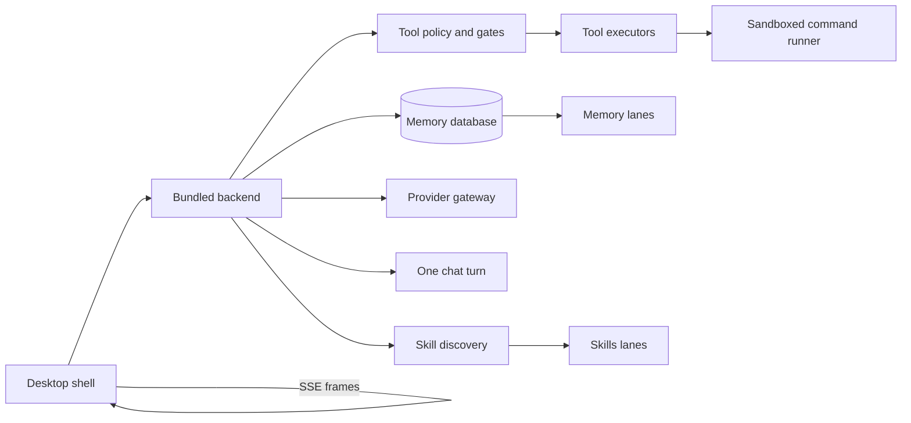

# August system map

August is a Tauri desktop app. A React shell talks to a bundled FastAPI
process over localhost, and that process is the only thing that reads or writes
the user's memory database.

The split matters when something goes wrong. The shell decides what you see and
keeps the transcript. The backend decides which tools a model may call, what it
can touch on disk, and what reaches the provider. A third piece, the tool
policy layer, sits between them and refuses work the other two would allow.

Open **One chat turn** for the lifecycle a single send goes through, including
the three ways it can stop without an answer. Open **Memory lanes** for what the
model can see and write. Open **Skills lanes** for how a skill is found, loaded
and learned.

## Who owns what

| Step | Owner | Notes |
| --- | --- | --- |
| Rendering the transcript, grouping tool runs | `frontend/desktop/src/components/shell/` | Render time only. The persisted shape is one block per tool call. |
| Deciding whether a tool call may run | `backend-py/app/services/sandbox/` | Policy is enforced at the call site, not in the advertised tool list. |
| Reading and writing memory | `backend-py/app/services/memory_store/` | The parent turn is the only model-facing write door. |
| Talking to a provider | `backend-py/app/providers/` | One wire format per model, chosen per request. |

## What this map does not cover

The Bot roster, the workbench code mode, the circuit and anatomy tool
families, and the mobile client are not modeled here. Each has its own owner and
would need its own page to be described honestly, so they are left out rather
than drawn from memory.
