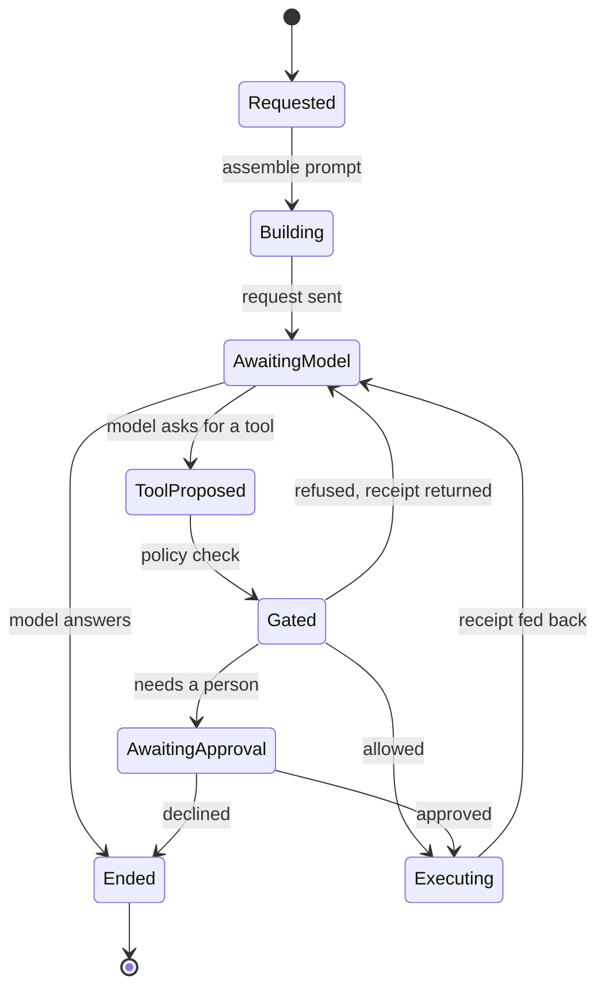

# One chat turn

You send a message. The backend builds a prompt, asks the model, and either gets
an answer or gets a tool call. A tool call is checked against policy, run, and
fed back as a receipt, and the model is asked again. That cycle repeats until
the model answers without asking for anything, or until a bound stops it.

Click **What ends a turn** for the eight reasons, which is the first thing to
read when a turn stops short.

## What ends a turn

Every turn closes with a `turn_end` frame carrying a reason. The reasons are a
closed list, and the transcript shows an amber badge for any stop that is not
`finished`.

| Reason | What it means |
| --- | --- |
| `finished` | The model answered and asked for nothing further. |
| `length` | The provider cut the answer at its token limit. |
| `cap` | The tool-round ceiling was reached. The last round is spent with no tools so the work comes back as a report. |
| `stall-stop` | No progress was detected across the stall window. |
| `budget` | An opt-in turn budget was breached and every relief rung was spent. |
| `error` | The request failed and no escape ladder could repair it. |
| `interrupted` | You stopped it. |
| `awaiting-input` | The turn is waiting on a person, not on a model. |

Two bounds are armed by default and they measure different things. The stall
counter resets whenever the model does genuinely new work, so a model that keeps
touching new files is not stopped by it. The second bound counts requests that
actually left the process, which is what stops a model that varies its arguments
forever while getting nowhere.

## What is not a lifecycle here

The turn is one request loop inside one session. A delegated subagent runs its
own loop with its own counters, and a Bot to Bot hop is a fresh turn in a
different session, so no counter above spans a chain.
