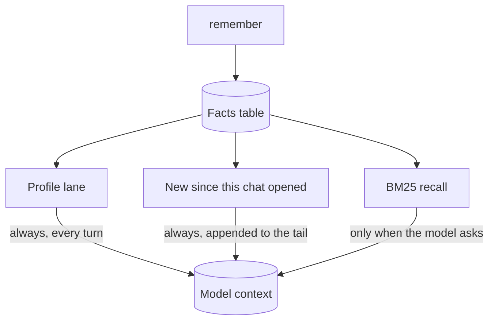

# Memory lanes

Stored memory reaches a turn three different ways, and they are not the same
mechanism. Confusing them is the usual reason a "why did it not remember"
investigation goes wrong.

## The three lanes

**Profile lane.** Facts stored with `kind='profile'` are rendered first, inside a
budget of about 600 characters, on every turn. This is what makes August
remember who you are without waiting for a keyword to match. It runs whether or
not automatic recall is on.

**Memory delta.** A plain list of facts written or updated since this chat
opened, appended to the prompt tail. It is a projection over the facts table,
not a cursor and not a second store, so an update to an existing key arrives
like a new write and a retired row cannot resurface. The comparison is on
`updated_at` at microsecond resolution, which is what lets a fact written in the
opening second of a chat be visible on the next request.

**Recall.** A BM25 search over the facts table, gated by the `memoryAutoInject`
setting, which is **off by default**. With it off, recall happens only when the
model itself calls `brain_query`. A fact dropped for budget reasons is named in a
`recall partial:` line rather than disappearing silently.

## Writing

`remember`, `list_facts` and `forget` are core tools, so progressive disclosure
can never hide the lookup that `remember` depends on, and a downgraded weak model
can still correct what it remembers.

`remember` refuses its first write in a turn until `list_facts` or a memory
search has run once. A sentence already stored under a different key is refused
with that key named in the result. Subagents read and recall but never write;
the parent turn is the only model-facing write door, and internal and UI routes
also call the same store function directly.

## What survives a reset

Backups are taken through the SQLite backup API on a read-only handle, checked
with `integrity_check` before one is trusted, and pruned to a verified rolling
set. A restore is staged and applied at the next launch, never swapped in place,
because other threads still hold the live file. What a restore replaced is kept
beside it.
