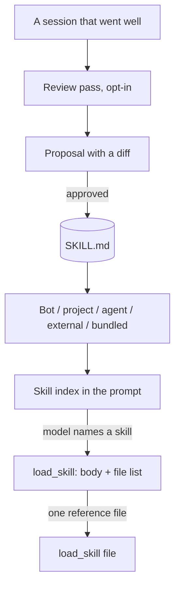

# Skills lanes

A skill is a procedure, not a rule. It lives in a folder with a `SKILL.md`,
frontmatter at byte 0, and a body whose sections say when to use it, when not
to, how to run it, and how to verify the result. The **description** is the
trigger: it is the only part a future turn sees before deciding to load the
body.

## Discovery

Five roots are searched in precedence order, and an earlier root wins a name
clash: the Bot's private root, the workspace's `.aug/skills`, the agent root,
operator-supplied external roots, and the bundled `<repo>/skills`. The project
root drops out when the workspace is the home directory or when
`projectSkills` is off. External roots are read-only: a write copies into the
agent or project root rather than mutating the operator's directory.

One walker feeds both discovery and the catalogue cache. It accepts an optional
category level (`<root>/<category>/<name>/SKILL.md`), never descends a
dot-directory or a symlinked directory, is depth- and count-bounded, and skips
a malformed skill **with a logged reason** while its siblings load.

## Loading

- **L1** — `load_skill(name)` returns the body, the file list and the absolute
  directory, so a later read has a real path to open.
- **L2** — `load_skill(name, file=…)` reads exactly one file inside that
  directory. Absolute paths and traversal are refused.

The index in the prompt is budgeted per context window: the name lines, the
descriptive lines and the intake count draw on one published budget. An alias
pre-read adds a hint-only line when the user's message names a skill; the body
still loads only through `load_skill`.

## Learning

The review pass reads one session that went well (not only a failure), judges
it, and routes verdicts through the same `apply_verdict` door as episode
learning. Progress is a per-session cursor map, so reviewing one session never
skips another. A draft below the substance bar becomes a memory lesson instead
of a padded skill. A proposal carries a diff; approval writes it; a replaced or
deleted skill lands in trash and can be restored. The pass is opt-in
(`memoryReview`, armed by default since 2026-10-24) and scheduled as the
`review` job.

## What the user sees

The Learning hub and the skill library list skills, show and edit their
triggers and bodies, and expose pack install with a preview, a content scan and
a confirmation step. Delete and restore are real doors. The open UX items —
including a listing that truncates the trigger, and a skill that disappears
without naming the gate that hid it — are tracked in
[`docs/specs/memory-and-skills.md`](../specs/memory-and-skills.md).

## What this page does not cover

The distiller's model-judgment quality (whether a given model drafts a good
skill) is not a mechanism this page can assert; it needs a funded provider.
The skill format itself is specified in `docs/SKILL_AUTHORING.md`.
