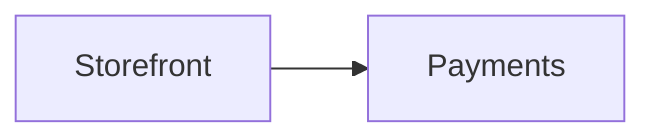
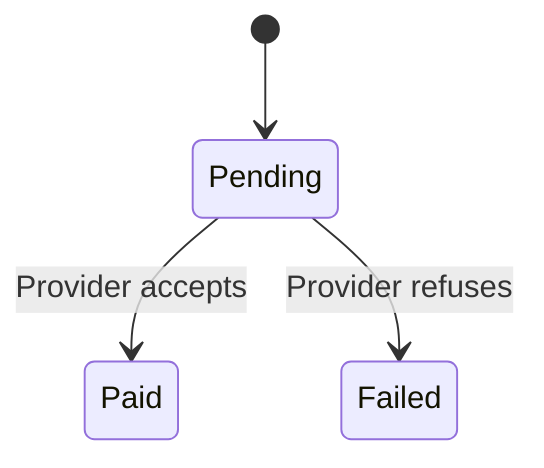

# Repository Markdown format

The local browser reads `docs/state` inside a selected project. Markdown is the
editable source. Generated SVG is a preview, not another document to maintain.

## Files and metadata

One system root lives at `docs/state/README.md`, with `parent: null`. Its ID need
not be `nessa`. All other documents name an existing parent ID. Keep folder
ownership consistent with that hierarchy. For example:

```text
docs/state/README.md
docs/state/services/payments/README.md
docs/state/services/payments/checkout/README.md
docs/state/services/payments/checkout/pay-for-an-order.md
docs/state/services/payments/payment-lifecycle.md
docs/state/gaps.md
```

Every page has YAML frontmatter and ordinary Markdown. Required fields:

```yaml
---
id: payment-lifecycle
title: Payment lifecycle
kind: statechart
status: implemented
summary: A payment can succeed, fail, or need another attempt.
parent: payments
sources:
  - src/payments.ts
diagramLinks: {}
---
```

IDs are stable lowercase kebab-case values. Titles and summaries are nonempty.
The root can use a project-specific title. Each `sources` entry is a project-relative
path; the browser checks existence but does not expose the source file's contents.
Use `[]` when there are no source references. The source remains the place for the
complete implementation.

| Field | Values |
| --- | --- |
| `kind` | `system`, `service`, `feature`, `flow`, `statechart`, `operation`, `contract`, `guide` |
| `status` | `implemented`, `mixed`, `fixture`, `proposed`, `reference` |
| `parent` | Another accepted document ID, or null for the root only |

Use `implemented` for behavior present in the inspected source, `fixture` for
examples or test wiring, and `proposed` for intended behavior that is not built.
Use `mixed` when a page includes more than one of those, and explain which parts.
Use `reference` for a guide or background material. A status is not a claim that
the code was deployed or that tests passed; report verification separately.

Unknown fields, duplicate IDs, missing parents, parent cycles and unresolved
diagram destinations are reported in Health. Folder/parent disagreement is a
warning. Each README owns the folder beneath it; metadata owns navigation. Do not
add a second navigation manifest.

Normal relative Markdown links to another accepted page navigate there. Source
links appear as references. HTML is not executed. A diagram uses a fenced
`mermaid` block. It can contain at most 100,000 UTF-16 code units, including
directives and comments. Split larger models at their actual owners.

## Source review checkpoint

Each page may record `sourceRevision` in its frontmatter:

```yaml
sourceRevision: "aa91831b5331d3461969f6a7be723a6d3325f29b"
```

This is the full lowercase Git commit ID (40 or 64 hexadecimal characters) of
**the documented repository's source reviewed for that page**. Quote it so YAML
keeps an all-numeric ID as text. Branch names, tags and short IDs are refused.
The value is authored evidence; the browser validates its form, not whether the
commit exists or the review was accurate.

The checkpoint lives in the repository being documented, under `docs/state`.
It is not the renderer's revision, the Markdown catalog's content hash, or the
commit that later adds the documentation. Do not use a self-referential future
commit ID. Record the source commit checked before committing the docs.

A page without this field displays “Source revision not recorded.” It does not
inherit a parent's or root's revision. A partial refresh advances only the pages
reviewed; navigation edits alone do not establish a fresh behavior audit. Keep
scope and exclusions in that page or its linked provenance notes. Do not claim
one atlas-wide revision when older pages have not been checked.

To investigate a later failure, read the page's full revision in Sources and
provenance and compare its linked source files at that commit with the failing
checkout. A checkpoint says what was reviewed, not that tests passed or that
newer commits are covered. Update it only after reconciling the page's behavior
against the newer source.

## Drill-down

`diagramLinks` maps a Mermaid node ID to an accepted document ID:

```yaml
diagramLinks:
  Payments: payments
```



Only mapped nodes navigate. A + marks them. Unmapped nodes stay neutral.

## State and decision explanations

`diagramDetails` is optional. It points to a heading in the same document, rather
than copying text into metadata:

```yaml
diagramDetails:
  - diagram: 0
    node: Pending
    section: Waiting for a reply
  - diagram: 0
    edge:
      from: Pending
      to: Failed
      label: Provider refuses
    section: Payment refused
```



```markdown
## Waiting for a reply

The payment request was sent, but the provider has not confirmed its result.
Waiting does not mean the payment succeeded.

## Payment refused

The provider refused this payment. The order remains unpaid. Explain the next
step supported by the actual implementation here.
```

`diagram` is the zero-based Mermaid block index. Select a `node` or an `edge`,
not both. Node IDs, endpoints and labels match the source exactly. `section` is
the exact plain heading text, unique in the document. A section includes its
nested headings and ends at the next heading at the same or higher level.
Headings inside lists or quotes do not define sections.

Bindings support `stateDiagram-v2` and ordinary `flowchart`/`graph` nodes and
plain labeled edges. Sequence messages and subgraph groups do not receive
explanation bindings. Duplicate edges with identical endpoints and labels are
ambiguous. Labels containing HTML, Markdown strings, Mermaid entity codes such
as `#quot;`, or a literal `|` cannot bind. Health reports a failed binding while
the page remains readable.

A node can have both navigation and an explanation. Its inspector shows the
explanation and offers the deeper page. Several elements may share a section.
Sequences in an explanation open in Details rather than creating another canvas
inside the inspector.

Standard shows the opening explanation, at most two blocks before a nested
heading. Full shows the whole authored section. Compact hides labels and notes
visually while preserving access to their explanations. Keep the important
condition and uncertainty in the first short paragraphs.
